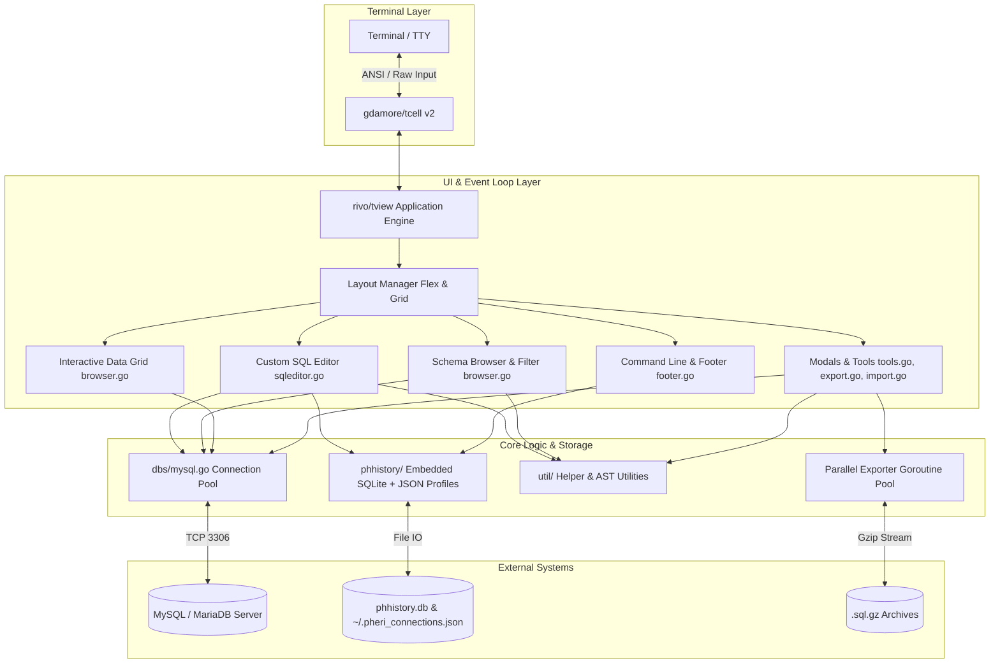

# 01 - Pheri Architecture & System Design

This document details the internal design, Go package structure, concurrency model, and lifecycle mechanics of **Pheri**.

---

## 1. High-Level System Architecture

Pheri is engineered as an ultra-low-overhead, event-driven Terminal User Interface (TUI) application written in Go. It operates directly in standard terminal emulators without external graphical dependencies, utilizing ANSI escape codes and raw terminal handling provided by `tcell` and `tview`.



---

## 2. Technology Stack & Key Dependencies

Pheri is built on Go 1.18+ with zero CGO dependencies for maximum portability:

| Component | Library / Package | Purpose |
| :--- | :--- | :--- |
| **TUI Framework** | `github.com/rivo/tview` | Provides rich terminal primitives: Flex layouts, Tables, Forms, TextAreas, Modals, and Lists. |
| **Terminal Screen & Input** | `github.com/gdamore/tcell/v2` | Low-level terminal abstraction, handling key events, mouse events, true-color ANSI rendering, and screen redrawing. |
| **MySQL Engine Driver** | `github.com/go-sql-driver/mysql` | Pure Go implementation of the MySQL network protocol for all database queries and streaming exports. |
| **Local History Database** | `modernc.org/sqlite` | Pure Go (CGO-free) embedded SQLite engine powering `phhistory.db` for zero-dependency query logging. |
| **Clipboard Integration** | `github.com/atotto/clipboard` | Multi-platform OS clipboard synchronization (X11, Wayland, macOS pasteboard, Windows clipboard). |
| **Compression** | `compress/gzip` (Go standard library) | High-throughput streaming compression and decompression for `.sql.gz` dump files. |

---

## 3. Package & Directory Breakdown

```
pheri/
├── main.go               # Program entry point, CLI flags, DB bootstrap, application runner
├── dbs/
│   └── mysql.go          # Database driver connection initialization and ping
├── phhistory/
│   ├── connections.go    # Saved connection profile persistence (~/.pheri_connections.json)
│   └── phhistory.go      # Local SQLite database initialization, query logging, and query fetching
├── ui/
│   ├── browser.go        # Main workspace coordinator, schema tree, data grid, inline cell editing, EXPLAIN
│   ├── connect.go        # Connection screen, profile dropdown, credentials form, environment selector
│   ├── sqleditor.go      # Custom SQL code editor, real-time tokenizer, autocompletion, snippets
│   ├── export.go         # Multi-threaded parallel export engine, selective export wizard, formatters
│   ├── import.go         # Streaming SQL/gzip import wizard, statement splitter, safety barriers
│   ├── processlist.go    # Live thread inspector, process list polling, instant KILL command
│   ├── tools.go          # Health dashboard, schema diff generator, history modal, query formatter, cell inspector
│   └── footer.go         # Status footer, keyboard hints, colon command dispatcher (:command)
└── util/
    └── util.go           # Identifier escaping, routine metadata resolution, clipboard helpers, focus styling
```

---

### Detailed Package Responsibilities

#### `main.go`
- Parses command line flags (`-u`, `-p`, `-host`, `-port`, `-history`, etc.).
- Resolves the runtime executable directory using `os.Executable()`.
- Bootstraps the local SQLite database at `<exeDir>/phhistory.db`.
- If the `-history` flag is supplied, prints query history directly to standard output and terminates without initializing the TUI.
- Initializes the `tview.Application` loop and launches `ui.ShowConnectionForm`.

#### `dbs/mysql.go`
- Exposes `dbs.Connect(user, pass, host, port string) (*sql.DB, error)` and `dbs.ConnectWithConfig(cfg ConnectConfig) (*sql.DB, error)`.
- Builds safe DSN strings using `mysql.Config` with configurable network timeouts (`timeout=5s`, `readTimeout=60s`, `writeTimeout=60s`), collation (`utf8mb4_general_ci`), and `parseTime=true`.
- Sets connection pooling limits on `*sql.DB` (`SetMaxOpenConns(25)`, `SetMaxIdleConns(5)`, `SetConnMaxLifetime(10m)`, `SetConnMaxIdleTime(3m)`).
- Provides `CategorizeConnectionError(err error) ConnectionErrorInfo` to diagnose connection errors (timeouts, connection refused, authentication failures, DNS issues) with user-friendly remediation hints.
- Validates network connectivity and credentials with `db.Ping()` before the main workspace loads.

#### `phhistory/`
- **`connections.go`**: Manages `ConnectionProfile` objects stored in `~/.pheri_connections.json`. Persists environment badges (`DEV`, `STAGING`, `PROD`), host, port, user, password, and read-only flags with restrictive file permissions (`0600`).
- **`phhistory.go`**: Creates and maintains the SQLite table `pheri_phhistory` storing `id`, `query_text`, `host_ip`, `db_name`, `user`, `port`, and `created_at`. Provides query recording (`SaveQuery`) and retention filtering (`FetchHistory`).

#### `ui/`
- **`connect.go`**: Renders the ASCII art header, saved profiles dropdown, host/port/user/password fields, environment selector, and read-only mode checkbox. Transitions into the main browser layout upon successful authentication.
- **`browser.go`**: The central UI hub (>3,600 lines). Controls the master `mainFlex` layout, loads schemas and objects (Tables, Views, Procedures, Functions), handles pagination (100 rows per page), implements inline cell editing with primary key resolution, and houses modals for EXPLAIN plans, schema inspection, and DDL extraction.
- **`sqleditor.go`**: A bespoke multi-line SQL editor built on `tview.TextView`. Runs a custom lexer/tokenizer on each keystroke to produce styled terminal markup, maintains cursor blink via `time.Ticker`, implements auto-closing quotes/brackets, and supports autocompletion (`Ctrl+T`) and snippet selection (`Ctrl+S`).
- **`export.go`**: Implements both a multi-threaded parallel export engine utilizing `runtime.NumCPU()` worker goroutines and an interactive selective export wizard supporting `.sql.gz`, `.sql`, CSV, and JSON.
- **`import.go`**: Implements a memory-efficient streaming import parser. It reads `.sql` and `.sql.gz` files line-by-line using `bufio.Reader`, detects SQL delimiters (`DELIMITER $$`), chunks statements, and temporarily disables foreign key checks for high-speed restoration.
- **`processlist.go`**: Polls `SHOW FULL PROCESSLIST`, formats threads into a selectable grid, and provides instant query termination (`KILL <id>`).
- **`tools.go`**: Provides the Health Dashboard (`F6`), Schema Diff and Migration Generator (`F7`), History modal (`Ctrl+H`), SQL query formatter (`:format`), and Cell Inspector.
- **`footer.go`**: Maintains the bottom status bar and intercepts colon commands (`:quit`, `:process`, `:explain`, `:health`, `:diff`, `:history`, `:format`, `:theme`, etc.).

#### `util/util.go`
- **`QuoteIdentifier(name)`**: Escapes backticks safely for table and column names (`"test` -> `` `test```).
- **`GetFullReturnType`**: Resolves return types and OUT parameter definitions for MySQL procedures and functions by querying `information_schema`.
- **`SetFocusWithBorder`**: Updates visual border colors dynamically when components gain or lose keyboard focus.

---

## 4. UI Layout & Viewport Architecture

Pheri arranges components using nested `tview.Flex` containers:

```
┌────────────────────────────────────────────────────────────────────────┐
│ Header: [DEV/STAGING/PROD] PHERI | Active DB: sales_db | Host: 127.0.0.1│
├───────────────────┬────────────────────────────────────────────────────┤
│ 📁 Sidebar        │ 📝 SQL Code Editor (ui/sqleditor.go)               │
│                   │    SELECT * FROM orders WHERE id = 100;            │
│ [Search: orders]  ├────────────────────────────────────────────────────┤
│ 🗄️ orders         │ 🧮 Result Data Table (ui/browser.go)               │
│ 🗄️ order_items    │ ┌────┬─────────┬──────────────┬──────────────────┐ │
│ 👁️ v_order_summary│ │ id │ user_id │ total_amount │ created_at       │ │
│ ⚡ sp_process_pay │ ├────┼─────────┼──────────────┼──────────────────┤ │
│                   │ │ 1  │ 45      │ 199.50       │ 2026-11-18 10:00 │ │
│                   │ └────┴─────────┴──────────────┴──────────────────┘ │
│                   │ [Page 1/5 | 100 Rows/Page | Enter: Edit Cell]      │
├───────────────────┴────────────────────────────────────────────────────┤
│ Footer: PHERI [DEV] | F1:Help | F3:Schema | F4:Top | Ctrl+R:Run | :cmd  │
└────────────────────────────────────────────────────────────────────────┘
```

### Focus Cycling & Border Styling
Focus is managed through `Tab` and `Shift+Tab`. When a component receives focus, its border color changes (e.g., lime or yellow) to provide clear visual feedback in the terminal. Pressing `Esc` at any point returns focus to the schema sidebar list.

---

## 5. Concurrency Model & Worker Pools

Pheri executes heavy database and disk operations off the main TUI event thread to prevent interface freezing:

1. **Parallel Worker Export (`ShowParallelWorkerExportModal`)**:
   - Queries `information_schema` for all tables, views, procedures, functions, triggers, and events.
   - Creates a work channel `chan ExportItem` and a results channel `chan ParallelExportResult`.
   - Spawns `runtime.NumCPU()` worker goroutines.
   - Each worker opens a dedicated database connection from the pool, extracts schema DDL and row data, and compresses output streams with `compress/gzip`.
   - The UI updates in real time via an asynchronous logger (`appendLog`) invoking `app.Draw()`.

2. **Streaming Import Parser (`processSQLFileStream`)**:
   - Imports stream directly from disk via buffered readers (`bufio.Reader`), handling multi-gigabyte dump files with minimal memory usage.
   - Dispatches progress messages to a channel that updates the TUI progress dialog without blocking the UI loop.

3. **Background Query Execution**:
   - Queries triggered from the editor (`Ctrl+R`) or table selection are executed with clean error recovery; syntax or runtime errors are caught and rendered into modal dialogs rather than crashing the process.

---

## 6. Safety Guards & Read-Only Enforcement

To prevent accidental data loss in production environments, Pheri implements a two-tier safety system:

1. **Visual Environment Guards**:
   - Tagging a connection with `-env PROD` tints borders and headers with bold red indicators, ensuring operators are always aware of high-stakes databases.
2. **Read-Only Mode (`ActiveReadOnly`)**:
   - When `-readonly` is enabled, any query containing non-SELECT mutation keywords (`INSERT`, `UPDATE`, `DELETE`, `DROP`, `ALTER`, `TRUNCATE`, `RENAME`, `REPLACE`) is intercepted and blocked before execution.
   - Inline cell editing in the result grid is completely deactivated.
   - Database import actions (`F9` / `:import`) are rejected immediately.
