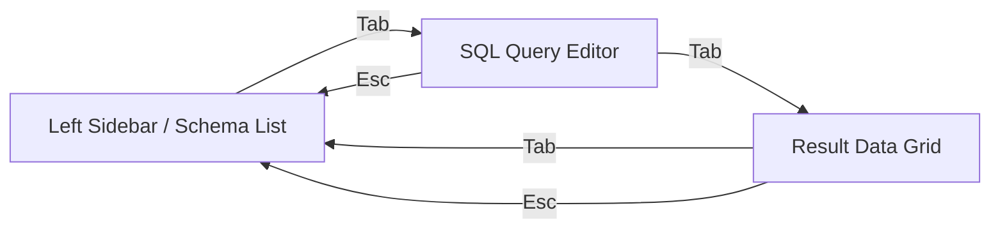

# 03 - UI Layout & Navigation Guide

This guide details the layout of Pheri's terminal workspace, active panel focus indicators, keyboard navigation, and the object filtering system.

---

## 1. Main Workspace Anatomy

Once authenticated, Pheri renders a balanced multi-pane terminal interface structured with `tview.Flex`:

```
┌────────────────────────────────────────────────────────────────────────────────────────┐
│ [DEV] PHERI | Active DB: e_commerce | Host: 127.0.0.1:3306 | User: root               │
├──────────────────────────┬─────────────────────────────────────────────────────────────┤
│ 📁 SCHEMAS & OBJECTS     │ 📝 SQL EDITOR  (Ctrl+R: Run | Ctrl+S: Snippets | Tab: Switch)│
│                          │                                                             │
│ Search: [table:order   ] │  SELECT                                                     │
│ ──────────────────────── │      o.id,                                                  │
│ 🗄️ TABLE orders          │      o.user_id,                                             │
│ 🗄️ TABLE order_items     │      o.total_amount,                                        │
│ 🗄️ TABLE order_statuses  │      o.created_at                                           │
│ 👁️ VIEW v_daily_orders   │  FROM orders o                                              │
│                          │  WHERE o.total_amount > 100                                 │
│                          │  ORDER BY o.id DESC;                                        │
│                          ├─────────────────────────────────────────────────────────────┤
│                          │ 🧮 RESULTS: orders (Page 1/4 | Rows: 100 | Time: 1.4ms)     │
│                          │ ┌────┬─────────┬──────────────┬───────────────────────────┐ │
│                          │ │ id │ user_id │ total_amount │ created_at                │ │
│                          │ ├────┼─────────┼──────────────┼───────────────────────────┤ │
│                          │ │ 94 │ 12      │ 320.00       │ 2026-11-18 14:22:01       │ │
│                          │ │ 93 │ 84      │ 115.50       │ 2026-11-18 13:58:12       │ │
│                          │ │ 92 │ 3       │ 450.00       │ 2026-11-18 12:10:45       │ │
│                          │ └────┴─────────┴──────────────┴───────────────────────────┘ │
│                          │ [▲/▼/◄/►: Navigate | Enter: Edit Cell | Ctrl+E: Export Grid]│
├──────────────────────────┴─────────────────────────────────────────────────────────────┤
│ PHERI [DEV] | F1:Help | F3:Schema | F4:Top | Ctrl+R:Run | Ctrl+E:Export | Tab:Switch   │
└────────────────────────────────────────────────────────────────────────────────────────┘
```

---

## 2. Workspace Panels

### 1. Header Banner (Top)
Displays high-visibility connection context:
- **Environment Badge**: Colored indicator (`[DEV]` in green/cyan, `[STAGING]` in yellow, `[PROD]` in red).
- **Active Database**: The currently selected MySQL schema.
- **Server Identity**: Host address, port, and authenticated user.

### 2. Schema Objects Sidebar (Left Pane)
Provides database and object navigation:
- **Database Switcher**: Lists accessible schemas. Selecting a database with `Enter` runs `USE <db>` and loads its object tree.
- **Smart Search Input**: Instant filter field for database objects.
- **Object Tree**: Lists all tables, views, stored procedures, and user functions with distinct icons (`🗄️` Tables, `👁️` Views, `⚡` Procedures, `🧮` Functions).

### 3. SQL Query Editor (Top Right Pane)
A full-featured custom terminal SQL editor (`ui/sqleditor.go`):
- Multi-line text input with line-based syntax coloring.
- Interactive cursor with smooth blinking and horizontal/vertical auto-scrolling.
- Auto-closing pairs for parentheses, brackets, and quotes.
- Table autocompletion (`Ctrl+T`) and boilerplate templates (`Ctrl+S`).

### 4. Result Data Grid (Bottom Right Pane)
Interactive data viewer (`tview.Table`):
- Formats query results into clean terminal tabular columns.
- Supports smooth keyboard scrolling across rows and columns.
- Pagination controls (100 rows per page) with Next/Previous page hotkeys.
- Inline cell editing on tables with primary keys.
- Quick result set export modal (CSV, JSON, Markdown, SQL inserts).

### 5. Status & Command Bar (Bottom)
Dynamic footer bar (`ui/footer.go`):
- Displays real-time operational messages (e.g. execution duration, row counts, export status).
- Provides hotkey hints for current context.
- Intercepts vim-style colon commands (e.g. `:process`, `:explain`, `:health`, `:diff`, `:format`, `:quit`).

---

## 3. Keyboard Focus & Panel Cycling

Pheri uses an intuitive cycling focus model so you never have to leave the keyboard:



| Key Binding | Focus Action |
| :--- | :--- |
| `Tab` | Advance focus to next pane: `Sidebar` ➔ `SQL Editor` ➔ `Result Grid` ➔ `Sidebar`. |
| `BackTab` (`Shift+Tab`) | Reverse focus to previous pane. |
| `Esc` | Immediately return focus to the Schema Objects Sidebar from any pane. |
| `F11` | Toggle fullscreen mode for the currently active panel (expands Editor or Grid to fill the screen). |

### Visual Focus Indicators
When a component receives focus, Pheri dynamically switches its border and title styling to a high-contrast color (Yellow or Lime Green). Blurred components dim to Dark Gray, ensuring you always know where keyboard input will land.

---

## 4. Smart Object Search & Prefix Filtering

The search bar above the schema list supports both raw substring searches and powerful structured prefix queries:

```
<prefix>:<keyword>
```

### Prefix Filter Syntax

| Prefix | Target Objects | Example Query | What it Does |
| :--- | :--- | :--- | :--- |
| `table:` | Tables only | `table:user` | Displays tables containing `user` (e.g. `users`, `user_tokens`). |
| `view:` | Views only | `view:summary` | Filters for views containing `summary`. |
| `procedure:` | Stored Procedures | `procedure:calc` | Filters procedures containing `calc`. |
| `function:` | User Functions | `function:tax` | Filters user-defined functions containing `tax`. |
| `db:` | Databases / Schemas | `db:analytics` | Filters the database list for schemas containing `analytics`. |

### Unprefixed Search
Typing a term directly without a prefix (e.g. `order`) performs a global match across all tables, views, procedures, and functions in the active database.

---

## 5. Sidebar Selection Actions

Selecting an object in the sidebar and pressing `Enter` executes smart context-aware actions:

- **Tables (`TABLE`)**: Automatically generates and executes:
  ```sql
  SELECT * FROM `table_name` LIMIT 100;
  ```
  The results load directly into the Data Grid, and inline cell editing is automatically enabled.
- **Views (`VIEW`)**: Executes a `SELECT *` preview query.
- **Stored Procedures & Functions**: Automatically fetches the routine's DDL (`SHOW CREATE PROCEDURE` or `SHOW CREATE FUNCTION`), formats it, and inserts it into the SQL Editor for inspection.
- **Copy DDL to Clipboard (`Ctrl+X`)**: Pressing `Ctrl+X` on any highlighted table generates its full `CREATE TABLE` DDL statement and copies it directly to your system clipboard.
