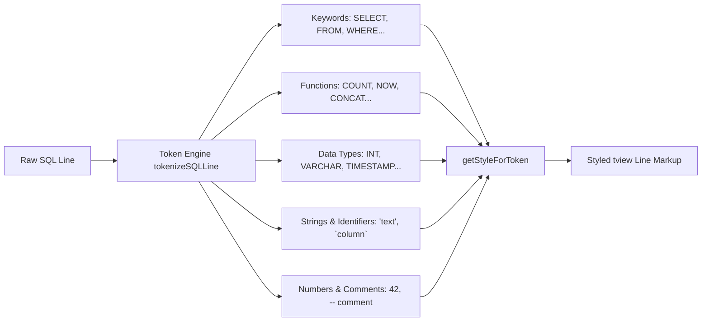

# 04 - SQL Editor, Syntax Highlighting & Snippets

This guide covers the features, keystrokes, tokenizer-based syntax highlighting, autocompletion, and boilerplate templates of Pheri's custom SQL Editor (`ui/sqleditor.go`).

---

## 1. Custom TUI Editor Overview

Rather than relying on basic terminal text boxes, Pheri implements a dedicated terminal code editor with features standard in modern desktop GUI editors:

- **Tokenized Real-Time Syntax Highlighting**: Colors SQL syntax dynamically as you type.
- **Active Cursor Engine**: Provides a smooth blinking cursor driven by an internal Go `time.Ticker` (500ms cycle).
- **Auto-Closing Delimiters**: Automatically pairs quotes (`'`, `"`, `` ` ``) and brackets (`(`, `[`, `{`).
- **Table Name Autocompletion (`Ctrl+T`)**: Live modal suggesting table names from the active database schema.
- **Boilerplate SQL Snippets (`Ctrl+S` / `Ctrl+Space`)**: Fast template insertion for common SQL operations.
- **Auto-Formatting (`:format` / `:fmt`)**: Normalizes keywords to uppercase and cleans query indentation.
- **Instant Query Execution (`Ctrl+R`)**: Runs the current query buffer against the connected database.

---

## 2. Tokenized Syntax Highlighting Engine

Every keystroke triggers the custom lexer (`tokenizeSQLLine` in `ui/sqleditor.go`). The lexer decomposes the SQL line into typed tokens and applies ANSI terminal colors:



### Color Palette Mapping

| Token Kind | Examples | Terminal Color |
| :--- | :--- | :--- |
| **SQL Keyword** | `SELECT`, `FROM`, `WHERE`, `JOIN`, `GROUP BY`, `ORDER BY`, `LIMIT`, `INSERT`, `UPDATE`, `DELETE` | `[lime::b]` (Bold Lime Green) |
| **SQL Function** | `COUNT`, `SUM`, `AVG`, `MAX`, `MIN`, `NOW`, `CONCAT`, `COALESCE`, `DATE_FORMAT` | `[yellow::b]` (Bold Yellow) |
| **Data Types** | `INT`, `BIGINT`, `VARCHAR`, `TEXT`, `DECIMAL`, `BOOLEAN`, `TIMESTAMP`, `DATETIME` | `[aqua::b]` (Bold Aqua Cyan) |
| **String Literals** | `'active'`, `"completed"` | `[green]` (Green) |
| **Backtick Identifiers** | `` `orders` ``, `` `user_id` `` | `[teal]` (Dark Cyan) |
| **Numeric Constants** | `100`, `3.14`, `0` | `[orange]` (Orange / Red) |
| **Comments** | `-- this is a comment`, `/* block comment */` | `[gray]` (Dim Gray) |
| **Operators & Punctuation** | `=`, `<>`, `>`, `<`, `+`, `-`, `*`, `,`, `;` | `[white]` (White) |

---

## 3. Auto-Closing Pairs

To accelerate typing in the terminal, Pheri automatically generates matching closing characters:

- Typing `'` produces `''` with the cursor positioned between the quotes.
- Typing `"` produces `""`.
- Typing `` ` `` produces ```` `` ````.
- Typing `(` produces `()`.
- Typing `[` produces `[]`.
- Typing `{` produces `{}`.

---

## 4. Table Name Autocompletion (`Ctrl+T`)

When writing queries in the editor, press `Ctrl+T` to open the dynamic **Table Autocompletion Modal**:

1. Pheri queries the active database's table list in memory.
2. An interactive popup list displays matching table names.
3. Use `▲` / `▼` arrow keys to highlight the desired table name.
4. Press `Enter` to insert the backtick-wrapped table name (e.g. `` `customers` ``) directly at the editor's cursor position.
5. Press `Esc` or choose `Cancel` to dismiss the modal without inserting.

---

## 5. SQL Snippets & Boilerplates (`Ctrl+S` / `Ctrl+Space`)

Press `Ctrl+S` or `Ctrl+Space` anywhere in the editor to open the **SQL Snippet Library**:

| Snippet Label | Generated SQL Code Template |
| :--- | :--- |
| **`SELECT * FROM table LIMIT 100`** | `SELECT * FROM `table_name` LIMIT 100;` |
| **`SELECT WITH WHERE & ORDER`** | `SELECT `column1`, `column2` FROM `table_name` WHERE `id` = 1 ORDER BY `id` DESC;` |
| **`INSERT INTO table`** | `INSERT INTO `table_name` (`col1`, `col2`) VALUES ('val1', 'val2');` |
| **`UPDATE table`** | `UPDATE `table_name` SET `col1` = 'val1' WHERE `id` = 1;` |
| **`DELETE FROM table`** | `DELETE FROM `table_name` WHERE `id` = 1;` |
| **`INNER JOIN tables`** | `SELECT a.*, b.* FROM `table1` a INNER JOIN `table2` b ON a.`id` = b.`foreign_id`;` |
| **`CREATE TABLE template`** | `CREATE TABLE `new_table` (`id` INT AUTO_INCREMENT PRIMARY KEY, `name` VARCHAR(100) NOT NULL, `created_at` TIMESTAMP DEFAULT CURRENT_TIMESTAMP);` |

Selecting any snippet immediately loads the boilerplate into your editor, ready for rapid editing.

---

## 6. SQL Query Formatting (`:format` / `:fmt`)

To clean up unformatted queries or legacy SQL dumps:
1. Type `:format` or `:fmt` in the command prompt (or use the footer command bar).
2. Pheri normalizes all SQL keywords to uppercase, aligns standard clauses (`SELECT`, `FROM`, `WHERE`, `GROUP BY`, `ORDER BY`), and strips extraneous blank lines.
3. The formatted SQL is immediately updated in the editor buffer.

---

## 7. Editor Keyboard Reference

| Key | Action |
| :--- | :--- |
| `Ctrl+R` | Execute current query buffer in active database. |
| `Ctrl+T` | Open Table Name Autocompletion Modal. |
| `Ctrl+S` / `Ctrl+Space` | Open SQL Snippet / Boilerplate Template Picker. |
| `Ctrl+P` | Paste clipboard text at cursor position. |
| `F11` | Expand SQL Editor to Fullscreen (or restore layout). |
| `Tab` | Switch focus from SQL Editor to Data Grid. |
| `Esc` | Return focus to the Schema Objects Sidebar. |
| `Enter` | Insert new line. |
| `Backspace` / `Delete` | Remove character before / at cursor. |
| Arrow Keys (`▲▼◄►`) | Move cursor through rows and columns. |
| `:clear` / `:cls` | Clear entire editor buffer. |
