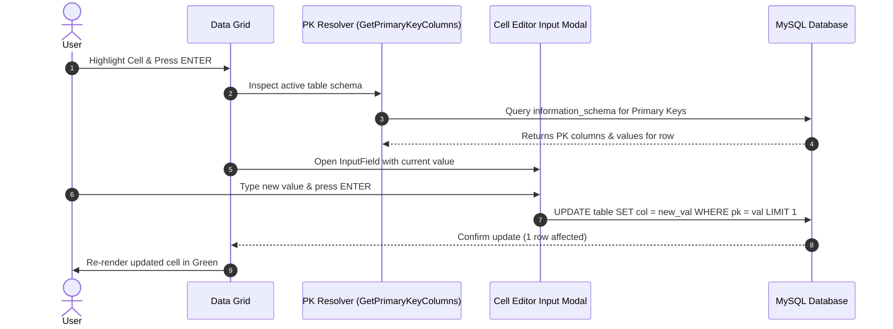

# 05 - Data Grid, Pagination & Inline Cell Editing

This guide covers the interactive Result Grid, pagination mechanisms, the inline cell editor, primary key resolution, and the deep cell inspector.

---

## 1. Result Grid Architecture

Query results are rendered in an interactive `tview.Table` component (`dataTable` in `ui/browser.go`):

- **Automatic Column Widths**: Column widths adapt dynamically based on header and data lengths.
- **Visual Column Headers**: Headers are styled with high-contrast bold yellow text on dark cyan/blue backgrounds.
- **Bidirectional Keyboard Navigation**: Move seamlessly across rows and columns using arrow keys (`▲`, `▼`, `◄`, `►`), `Home`, `End`, `PageUp`, and `PageDown`.
- **Query Execution Statistics**: The table title displays the active table name, page number, row count, and execution latency in milliseconds.

```
┌────┬─────────┬──────────────────────┬──────────────┬─────────────────────┐
│ id │ user_id │ email                │ balance      │ created_at          │
├────┼─────────┼──────────────────────┼──────────────┼─────────────────────┤
│ 1  │ 101     │ alice@example.com    │ 1250.00      │ 2026-11-18 09:15:00 │
│ 2  │ 102     │ bob@example.com      │ 340.50       │ 2026-11-18 10:22:18 │
│ 3  │ 103     │ charlie@example.com  │ 89.00        │ 2026-11-18 11:05:42 │
└────┴─────────┴──────────────────────┴──────────────┴─────────────────────┘
[Page: 1/12 | Displaying Rows 1-100 of 1,200 | Enter: Edit | i: Inspect Cell]
```

---

## 2. Pagination Controls

To maintain high performance and low memory consumption when querying tables with millions of rows, Pheri buffers records in pages of 100 rows (`gridPageSize = 100`):

| Action | Keystroke | Behavior |
| :--- | :--- | :--- |
| **Next Page** | `Ctrl+N` or `]` | Fetches the next 100 rows (`OFFSET currentGridPage * 100`). |
| **Previous Page** | `Ctrl+B` or `[` | Returns to the previous 100 rows. |
| **First Page** | `Home` | Jumps to row 1 on page 1. |
| **Page Up / Down** | `PgUp` / `PgDn` | Rapidly scrolls 10 visible rows within current page. |

---

## 3. Inline Cell Editing with Primary Key Resolution

Pheri allows developers to modify database records directly from the terminal without manually crafting `UPDATE` queries.



### Step-by-Step Inline Editing Workflow:
1. Navigate to any data cell in the table grid using arrow keys.
2. Press `Enter`.
3. Pheri automatically identifies:
   - The active table and database.
   - The selected column name and current value.
   - The row's primary key(s) by querying `information_schema.table_constraints` and `information_schema.key_column_usage`.
4. An inline edit prompt opens pre-filled with the existing value.
5. Edit the text and press `Enter` to commit (or `Esc` to cancel).
6. Pheri generates and executes an atomic query:
   ```sql
   UPDATE `database_name`.`table_name`
   SET `column_name` = 'updated_value'
   WHERE `primary_key` = 'pk_value'
   LIMIT 1;
   ```
7. The cell updates immediately in the grid with a success notice in the footer.

### Read-Only Safeguard Interception
If the connection has **Read-Only Mode** enabled (`ActiveReadOnly = true`), pressing `Enter` will not open the edit dialog. Instead, Pheri presents an alert:
```
🔒 Modification Blocked: Active Connection is in READ-ONLY Mode.
```

---

## 4. Deep Cell Inspector (`ShowCellInspectorModal`)

When examining columns containing long strings, JSON documents, stack traces, or binary BLOBs that do not fit in a standard table column:

1. Highlight the cell and press `i` or trigger the Cell Inspector.
2. A full-screen dialog opens displaying the raw content with automatic line wrapping.
3. **JSON Formatting**: If the content is valid JSON, Pheri formats and indents the JSON structure for readability.
4. **Hex View**: For binary or serialized data, Pheri displays the raw byte hex representation.
5. **Clipboard Copy**: Press `c` inside the inspector to copy the full cell text to the clipboard.
6. Press `Esc` or `Enter` to close the inspector and return to the data grid.

---

## 5. Result Set Export Wizard (`showExportResultsModal`)

You can export the currently visible query result set directly from the grid:

1. Press `Ctrl+E` while the result grid is focused.
2. Select your desired export format:
   - **CSV (`.csv`)**: Comma-separated values with quoted fields and headers.
   - **JSON (`.json`)**: Array of JSON objects mapped to column names.
   - **Markdown Table (`.md`)**: Formatted GitHub-Flavored Markdown table ready for docs or pull requests.
   - **SQL Insert Statements (`.sql`)**: Batch `INSERT INTO table_name VALUES (...)` scripts.
3. Choose destination: Save to a local file or copy directly to system clipboard.
