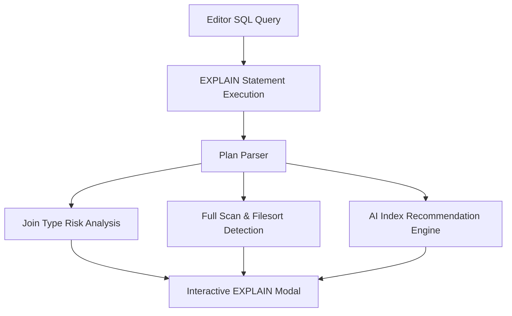

# 06 - Performance, Diagnostics & DBA Tools

This guide covers Pheri's built-in DBA tooling for real-time server monitoring, query performance profiling, thread management, and schema integrity verification.

---

## 1. Live Process Manager (`F4` / `:process`)

The Live Process Manager allows you to monitor active client connections and kill hung or runaway queries directly from your terminal.

```
┌────────────────────────────────────────────────────────────────────────────────────────┐
│ ⚡ MYSQL LIVE PROCESS MANAGER & ACTIVE THREAD MONITOR                                  │
├──────┬──────────┬──────────────────┬──────────┬─────────┬──────┬─────────┬─────────────┤
│ ID   │ USER     │ HOST             │ DB       │ COMMAND │ TIME │ STATE   │ QUERY INFO  │
├──────┼──────────┼──────────────────┼──────────┼─────────┼──────┼─────────┼─────────────┤
│ 142  │ web_app  │ 192.168.1.15:43  │ shop_db  │ Query   │ 42s  │ Sending │ SELECT * F..│
│ 145  │ root     │ localhost        │ shop_db  │ Sleep   │ 2s   │         │ NULL        │
│ 148  │ worker   │ 192.168.1.20:51  │ analytics│ Query   │ 0s   │ Executing│ UPDATE sta..│
└──────┴──────────┴──────────────────┴──────────┴─────────┴──────┴─────────┴─────────────┘
[▲/▼: Select Thread | ENTER / K: Terminate Query (KILL id) | ESC / F4: Close]
```

### Features:
- **`SHOW FULL PROCESSLIST` Inspection**: Displays all connection threads across databases.
- **Runaway Query Detection**: Highlights threads with high execution times (`Time > 30s`) in yellow or red.
- **Instant Query Termination**: Select any thread row and press `Enter` or `K`. Pheri prompts for confirmation and executes:
  ```sql
  KILL <thread_id>;
  ```
- **Safe Refresh**: Press `r` to refresh the thread list on demand.

---

## 2. EXPLAIN Execution Plan Analyzer (`F5` / `:explain`)

Pressing `F5` or typing `:explain` runs MySQL's `EXPLAIN` engine on the SQL query currently loaded in your editor and displays an interactive diagnostic breakdown:



### Plan Diagnostic Views:

#### 1. Plan Health Score
Pheri grades the query plan on a scale from 0 to 100 based on join types, row estimates, and execution warnings:
- **`90 - 100` (Optimal)**: Uses `const`, `eq_ref`, or unique index lookups.
- **`60 - 89` (Moderate)**: Uses `range` scans or `ref` lookups with indexes.
- **`< 60` (Critical Warning)**: Full table scans (`ALL`), temporary tables, or `Using filesort`.

#### 2. Join Type Classification
| Join Type | Performance Risk | Action Required |
| :--- | :--- | :--- |
| `system` / `const` | 🟢 Excellent | Table has at most one matching row. Fastest possible lookup. |
| `eq_ref` | 🟢 Excellent | One row read per row from previous table via Primary Key / Unique index. |
| `ref` | 🟡 Good | Non-unique index lookup. Good for standard indexed joins. |
| `range` | 🟡 Moderate | Index range scan (e.g. `WHERE id BETWEEN 10 AND 50`). |
| `index` | 🟠 Warning | Full index scan. Reads the entire index tree. |
| `ALL` | 🔴 Severe | **Full Table Scan**. MySQL reads every disk row in the table. Index required! |

#### 3. Warning Detection
Pheri scans the `Extra` column and flags:
- **`Using filesort`**: MySQL cannot use an index to resolve `ORDER BY` and must perform an extra sorting pass in memory or disk.
- **`Using temporary`**: A temporary disk table is required to resolve `GROUP BY` or `DISTINCT`.
- **`Full Table Scan on Large Table`**: Alerts when an unindexed table scan evaluates more than 1,000 rows.

#### 4. Automated Index Recommendations (`buildIndexRecommendationText`)
Pheri analyzes tables flagged with `ALL` or `filesort` and suggests specific `CREATE INDEX` statements to eliminate bottlenecks:
```sql
-- Recommendation:
ALTER TABLE `orders` ADD INDEX `idx_orders_status_created` (`status`, `created_at`);
```

---

## 3. Real-Time Health & Metrics Dashboard (`F6` / `:health`)

Pressing `F6` or typing `:health` queries `SHOW GLOBAL STATUS` and `SHOW GLOBAL VARIABLES` to render a comprehensive server dashboard:

| Category | Metric Name | Optimal Value | Description |
| :--- | :--- | :---: | :--- |
| **Server Status** | Server Version | Current | Displays MySQL/MariaDB version string. |
| **Server Status** | Uptime | > 0 | Total continuous operating uptime in seconds. |
| **Traffic & Load** | Total Executed Queries | Continuous | Cumulative query count processed by the server. |
| **Connections** | Threads Connected / Max | < 80% Max | Active client connections vs. `max_connections` limit. |
| **Connections** | Threads Running | Low | Threads actively executing statements right now. |
| **Performance** | Slow Queries | 0 or Low | Queries taking longer than `long_query_time` (default > 1s). |
| **Memory & Cache** | InnoDB Buffer Read Hit Ratio | **> 99%** | Percentage of read requests satisfied from RAM vs disk. |
| **Memory & Cache** | InnoDB Buffer Pool Size | Configured | Total RAM allocated to caching data and indexes. |

Press `c` inside the dashboard to copy the full metrics report to your clipboard for status checks or incident reports.

---

## 4. Schema Diff & Migration Generator (`F7` / `:diff`)

Pressing `F7` or typing `:diff` runs a structural integrity scan on the active schema:

1. **Table Inventory**: Discovers all tables and total table counts.
2. **Index Verification**: Checks each table via `SHOW INDEX` to ensure a Primary Key or Secondary Index exists. Tables lacking indexes are highlighted with a `⚠️ No Primary Key / Index` warning.
3. **Column Counting**: Audits column definitions across tables.
4. **Auto-Generated Verification SQL**: Outputs ready-to-run integrity validation queries:
   ```sql
   SELECT TABLE_NAME, ENGINE, TABLE_ROWS, DATA_LENGTH
   FROM INFORMATION_SCHEMA.TABLES
   WHERE TABLE_SCHEMA = 'active_database';
   ```
5. Press `c` to copy the generated migration script directly to your clipboard.
