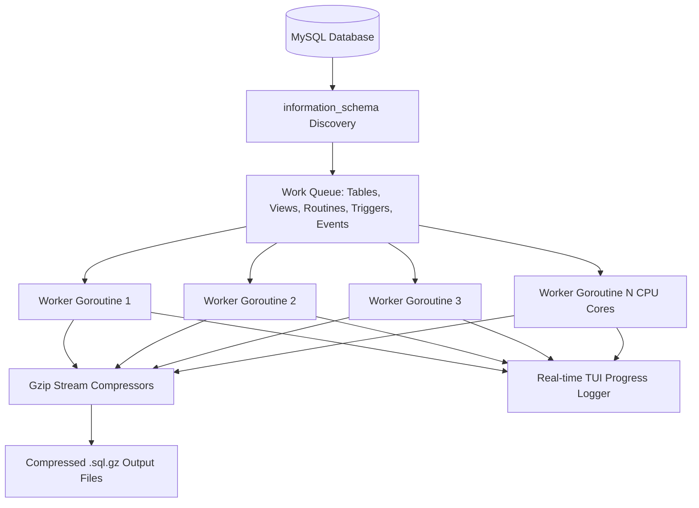
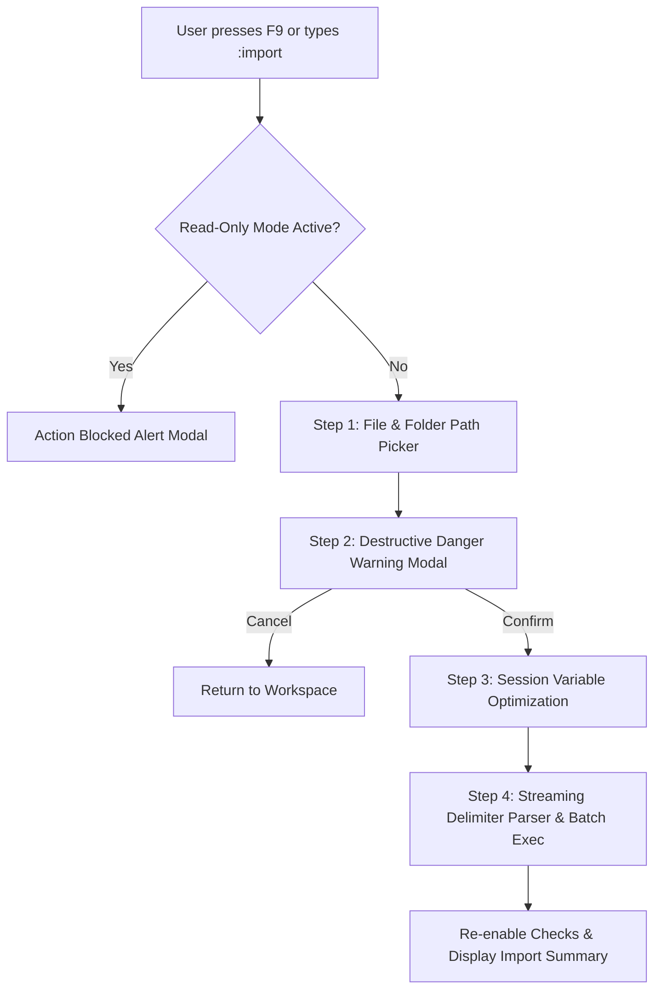

# 07 - Backup & Restore Engines

This guide details Pheri's backup and restoration subsystems, including CPU-tuned parallel exports, Gzip compression, the selective export wizard, and the safe interactive import wizard.

---

## 1. High-Speed Compressed Export (`.sql.gz`)

Traditional database dump utilities (e.g. standard single-threaded `mysqldump`) write uncompressed text files that consume massive disk storage and bottleneck on I/O. 

Pheri implements an in-memory streaming Gzip pipeline (`compress/gzip` in Go):
- **Up to 95% Size Reduction**: Compresses schema definitions and row inserts on the fly.
- **Complete Object Coverage**: Exports tables, views, stored procedures, user-defined functions, triggers, and scheduled events.
- **Universal Tool Compatibility**: Pheri's `.sql.gz` archives are standard Gzip archives containing valid MySQL SQL scripts. They can be restored with:
  ```bash
  # Restore using standard MySQL CLI
  zcat dump.sql.gz | mysql -u root -p database_name

  # On macOS / BSD
  gzcat dump.sql.gz | mysql -u root -p database_name
  ```
  Compatible with DBeaver, Navicat, phpMyAdmin, and MySQL Workbench.

---

## 2. High-Speed Parallel Worker Export (`Ctrl+W` / `F8`)

For large databases, Pheri features a multi-threaded parallel export engine (`ShowParallelWorkerExportModal` in `ui/export.go`):



### Worker Pool Mechanics:
1. Pheri queries `information_schema` to build an inventory of all database objects.
2. It detects available CPU hardware cores using `runtime.NumCPU()` and launches that number of concurrent worker goroutines.
3. Each worker consumes objects from a synchronized Go channel, creates dedicated database connections, extracts DDL and row data, and streams the output directly into Gzip archives.
4. An interactive terminal log modal displays live progress as each table finishes dumping.

### Keystroke to Launch:
Press `Ctrl+W` or `F8` from any active database view.

---

## 3. Selective Export Wizard (`Ctrl+E` / `:export`)

When you do not need the entire database, press `Ctrl+E` to open the **Selective Export Wizard**:

### Step 1: Object Selector Modal
- Lists every table, view, stored procedure, function, trigger, and event in the active schema with checkboxes.
- Use arrow keys and `Space` to toggle individual items.
- Hotkeys:
  - `a`: Select All objects.
  - `n`: Deselect All.
  - `Enter`: Proceed to Export Settings.

### Step 2: Export Settings Form
Configure exact dump parameters:
- **Include Schema (DDL)**: `true` / `false` (`CREATE TABLE`, `CREATE VIEW`, etc.).
- **Include Data (Rows)**: `true` / `false` (`INSERT INTO` row data).
- **Export Format**: Choose between:
  - `SQL (.sql.gz)`: Compressed MySQL archive (default).
  - `SQL (.sql)`: Plaintext MySQL dump file.
  - `JSON (.json)`: Structured JSON export for API consumption.
  - `CSV (.csv)`: Comma-separated files for spreadsheet analysis.
- **Output Destination**: Specify file or folder path (defaults to `./export/<db_name>_<timestamp>`).

---

## 4. Database Import Wizard (`F9` / `:import`)

Restoring databases is a potentially destructive operation. Pheri implements an interactive, multi-step import wizard (`ui/import.go`) equipped with safety barriers:



### Step-by-Step Import Flow:

#### 1. Read-Only Guard Validation
If the current connection is running in Read-Only mode (`ActiveReadOnly = true`), Pheri immediately halts:
```
🔒 Action Blocked: Active Connection is in READ-ONLY Mode.
Importing database dumps is not allowed while Read-Only mode is enabled.
```

#### 2. Source Path Picker
Specify the file or directory containing backup dumps. Pheri auto-detects:
- Single `.sql` plaintext files.
- Single `.sql.gz` compressed files.
- Export folders containing multiple chunked dump files.

#### 3. Destructive Operation Confirmation Modal
Before modifying the database, Pheri displays a high-visibility warning:
```
⚠️ DANGEROUS / DESTRUCTIVE OPERATION!
Target Database: sales_db
Import Source: ./export/sales_db_backup.sql.gz (Single Dump File)

CRITICAL WARNING: Importing this source will execute DDL and DML statements 
which may DROP existing tables, OVERWRITE schema definitions, or REPLACE data.
```
You must explicitly confirm by selecting `[ YES, OVERWRITE & IMPORT ]`.

#### 4. Import Session Optimizations
To ensure high restoration throughput and avoid foreign key circular dependency deadlocks, Pheri executes session configuration before importing:
```sql
SET FOREIGN_KEY_CHECKS = 0;
SET UNIQUE_CHECKS = 0;
SET AUTOCOMMIT = 0;
```
Once the import finishes, it runs `COMMIT;` and restores foreign key checks.

#### 5. Streaming Statement Splitter
Pheri parses dump files through a streaming delimiter parser (`splitSQLStatements`):
- Handles multi-megabyte `INSERT` blocks efficiently without high memory usage.
- Correctly parses custom stored procedure and trigger delimiters (e.g. `DELIMITER $$`).
- Displays a real-time progress counter showing total statements processed and remaining.
