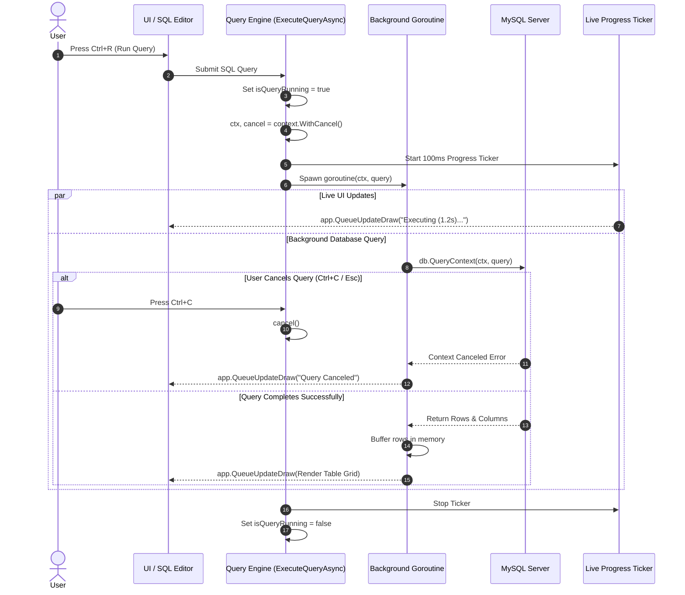

# PHERI-01: Async Query Execution with Context Cancellation

- **Task Code**: `PHERI-01`
- **Feature Name**: Asynchronous Query Execution with Real-Time Cancellation
- **Category**: Core Reliability & Engine
- **Priority**: `P0 - Critical`
- **Status**: `Completed` ✅
- **Target Files**: `ui/browser.go`, `dbs/mysql.go`, `ui/footer.go`, `ui/sqleditor.go`

---

## 1. Reason of Adding

In the current implementation of Pheri, every query executed—whether from the SQL code editor (`Ctrl+R`), the table selector in the sidebar, or pagination controls—is called via a synchronous `db.Query(query)` call directly on the primary event loop thread of the `tview.Application`.

When a database query takes more than a fraction of a second (for example, joining multi-million row tables, querying an unindexed column, executing an expensive aggregation, or running `SELECT SLEEP(10)`):
- The entire terminal UI freezes immediately.
- The event loop stops processing keystrokes, mouse clicks, and terminal resize events.
- Redrawing (`app.Draw()`) is completely blocked, meaning no spinner, progress timer, or status update can be rendered.
- If the user presses `Ctrl+C` out of frustration, the entire Pheri process is abruptly terminated, but the MySQL server continues running the expensive query in the background, consuming CPU and holding table locks.

`PHERI-01` introduces a non-blocking asynchronous execution architecture using Go goroutines, `context.WithCancel`, thread-safe UI rendering via `app.QueueUpdateDraw`, and graceful `Ctrl+C` query abortion.

---

## 2. Scenario

### Scenario A: The Accidental Full-Table Query
A developer connects to a staging or production database containing an `audit_logs` table with 15 million rows. They type `SELECT * FROM audit_logs WHERE message LIKE '%error%';` and press `Ctrl+R`.
- **Current Behavior**: The terminal completely freezes. Keystrokes produce no response. The developer cannot tell if Pheri crashed or is still working. Pressing `Ctrl+C` kills the terminal session.
- **Enhanced Behavior with PHERI-01**: Pheri immediately updates the status bar with an active progress indicator: `⚡ Executing Query... (3.2s) | Press Ctrl+C or Esc to Cancel`. The user presses `Ctrl+C`. Pheri aborts the query within milliseconds, displays `⚠️ Query Canceled by User (aborted after 3.2s)`, and keeps the editor and data grid completely intact.

### Scenario B: Database Network Blip / Hanging Lock
A query is submitted while another client holds an exclusive table lock (`LOCK TABLES` or an open transaction).
- **Current Behavior**: Pheri hangs indefinitely waiting on the database server.
- **Enhanced Behavior with PHERI-01**: The UI remains fully responsive. A live execution timer increments every 100ms. The user can either let it wait or cancel it at any second with a single keystroke.

---

## 3. Why This Is Critical

1. **User Experience & Responsiveness**: Terminal applications must feel instant. Blocking the UI loop breaks user trust and gives the impression that the software has crashed.
2. **Server Resource Protection**: If a developer kills their local terminal process to escape a frozen screen, the server does not necessarily cancel the running thread immediately. By providing a clean in-app abort mechanism, Pheri can send an immediate `context.Cancel` / `KILL QUERY` to the database engine.
3. **Foundation for Advanced Features**: Asynchronous execution is a prerequisite for multi-query execution, background table indexing, query time profiling, and live query cancellation.

---

## 4. How It Works (Technical Architecture)

### Key Technical Mechanisms:

1. **`context.WithCancel`**:
   - Each query creates an isolated context derived from `context.Background()`.
   - The `cancel` function is stored in `activeQueryCancel`.
2. **Off-Thread Row Buffering**:
   - Both `db.QueryContext` and `rows.Scan()` run inside the background worker goroutine.
   - Rows are collected into a thread-safe `QueryResult` buffer before touching the UI.
3. **`app.QueueUpdateDraw`**:
   - Once all rows are buffered, `app.QueueUpdateDraw` is called to atomically populate `dataTable` and redraw the screen on the UI thread without concurrency races.
4. **Key Interception for Cancellation**:
   - When `isQueryRunning == true`, pressing `Ctrl+C` or `Esc` intercepts the event, calls `activeQueryCancel()`, and displays a cancellation notice instead of quitting the application.
5. **DML Mutation Support (`db.ExecContext`)**:
   - Queries starting with `INSERT`, `UPDATE`, `DELETE`, `ALTER`, `DROP`, `CREATE` are executed via `db.ExecContext`, capturing `RowsAffected()` and execution duration without attempting to scan row columns.

---

## 5. Impact Analysis

| Dimension | Before (Current) | After (PHERI-01) |
| :--- | :--- | :--- |
| **UI Responsiveness** | Freezes completely on any slow query | 100% interactive at all times |
| **Progress Visibility** | Blank/frozen screen with no feedback | Live elapsed timer updated every 100ms |
| **Query Cancellation** | None (killing process kills app) | Graceful cancellation via `Ctrl+C` or `Esc` |
| **DML Statements** | `db.Query` fails to show affected rows | `db.ExecContext` reports `RowsAffected` cleanly |
| **Server Health** | Abandoned queries can linger and lock tables | Canceled queries release server resources quickly |
| **Code Safety** | High risk of race conditions on UI redraw | Safe synchronization via `app.QueueUpdateDraw` |

---

## 6. Implementation Plan & Work Breakdown

### Step 1: Query Execution State & Structs (`ui/browser.go`)
- Define `QueryResult` struct for buffering columns, rows, execution duration, and rows affected.
- Define query execution state variables with synchronization primitives:
  - `var isQueryRunning atomic.Bool`
  - `var activeQueryCancel context.CancelFunc`
  - `var activeQueryMutex sync.Mutex`

### Step 2: Implement `ExecuteQueryAsync`
- Replace synchronous `ExecuteQuery` with an asynchronous worker that accepts a completion callback.
- Run `db.QueryContext` for SELECT statements and `db.ExecContext` for DML mutations.
- Catch `context.Canceled` and render a clear warning status.

### Step 3: Implement Live Execution Ticker & Status Updates
- Launch a background `time.NewTicker(100 * time.Millisecond)` to render elapsed time in the footer bar:
  `[yellow::b]⚡ Executing query... (1.4s) | [lime]Ctrl+C / Esc:[-] Cancel`

### Step 4: Intercept Keyboard Cancellation
- Update `app.SetInputCapture` and `activeSQLEditor.Editor.SetInputCapture` to intercept `Ctrl+C` and `Esc` when `isQueryRunning == true`.
- Trigger `activeQueryCancel()` safely and consume the key event so Pheri does not exit.

### Step 5: Update All Invocations
- Update query triggers in `activeSQLEditor.OnExecute`, table sidebar selection, and pagination (`Ctrl+N`/`Ctrl+P`) to use `ExecuteQueryAsync`.

### Step 6: Automated Unit & Stress Tests
- Add automated tests in `ui/export_test.go` (or `ui/query_test.go`) validating:
  - Context cancellation under `SELECT SLEEP(5)`.
  - Immediate abort when `cancel()` is triggered.
  - Safe handling of DML mutations and empty result sets.

---

## 7. Verification & Completion Status

- [x] **Non-blocking Execution**: Queries execute in dedicated goroutines (`ExecuteQueryAsync`). UI event loop never freezes.
- [x] **Context Cancellation**: User can abort running queries anytime with `Ctrl+C` or `Esc`.
- [x] **Live Progress Indicator**: Live ticker dynamically increments and displays execution duration (`UpdateFooterRunningQuery`).
- [x] **DML Mutation Support**: `INSERT`, `UPDATE`, `DELETE` queries run via `db.ExecContext`, returning `RowsAffected`.
- [x] **Thread-Safe UI Sync**: Background row scanning buffers rows in memory before atomically rendering to `dataTable` via `app.QueueUpdateDraw`.
- [x] **Automated Tests**: Unit test suite in `ui/query_async_test.go` passing 100%.
- [x] **Production Executable Built**: Verified in `pheri.exe` and `build/pheri-windows-amd64.exe`.
