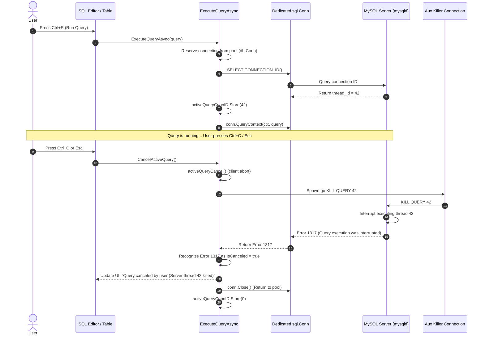

# PHERI-02: Active Query Abort on Ctrl+C / Esc & MySQL Server-Side KILL QUERY

- **Task Code**: `PHERI-02`
- **Feature Name**: Active Query Abort on Ctrl+C / Esc with Server-Side Thread Termination
- **Category**: Core Reliability & Engine
- **Priority**: `P0 - Critical`
- **Status**: `Completed` ✅
- **Target Files**: `ui/browser.go`, `ui/footer.go`, `main.go`, `ui/query_async_test.go`

---

## 1. Reason of Adding

In standard Go database drivers (including `go-sql-driver/mysql`), cancelling a client context (`context.WithCancel`) notifies the local application to stop waiting for network I/O. However, on the MySQL server:
- The server thread executing the query **continues running in the background** inside `mysqld`.
- For expensive queries (unindexed full table scans, large cross joins, or aggregations over millions of rows), orphaned server queries consume 100% CPU and memory on the database host.
- More dangerously, long-running queries often hold exclusive InnoDB row or metadata locks, causing subsequent updates and transactions to queue up, leading to lock wait timeouts or cascading application downtime.
- In terminal environments, if an unhandled `Ctrl+C` event is received by the shell or application outside of query execution, it can abruptly terminate the entire local Pheri process, losing unsaved SQL queries in the editor buffer.

`PHERI-02` solves these critical failure modes by implementing **synchronous connection thread tracking** and **dual-action client + server query aborting**. When a user presses `Ctrl+C` or `Esc`, Pheri immediately aborts the local UI wait state and simultaneously issues `KILL QUERY <connection_id>` on the MySQL server, instantly halting execution and freeing database locks.

---

## 2. Real-World Failure Scenarios Prevented

### Scenario A: The Runaway Table Scan
A developer accidentally types `SELECT * FROM payment JOIN rental JOIN inventory;` without a `WHERE` clause or `LIMIT` on a production replica.
- **Previous Failure Mode**: Pressing `Ctrl+C` terminates the client-side context. Pheri stops waiting, but the MySQL server thread continues computing Cartesian products for minutes, saturating replica CPU and triggering alerts.
- **Enhanced Behavior with PHERI-02**: When the developer presses `Ctrl+C`, Pheri immediately grabs the tracked connection ID (e.g. `Thread 84`) and issues `KILL QUERY 84` on an auxiliary connection. The MySQL server immediately aborts the thread with `Error 1317 (Query execution was interrupted)`. Database CPU usage returns to baseline within milliseconds.

### Scenario B: Accidental Terminal Process Termination
A user is reviewing complex query results or editing a 50-line stored procedure and accidentally presses `Ctrl+C` thinking they are in bash or another command.
- **Previous Failure Mode**: In some terminals, uncaptured `Ctrl+C` kills Pheri, losing uncommitted text.
- **Enhanced Behavior with PHERI-02**: If no query is actively executing, `Ctrl+C` in the SQL editor safely copies the selection or query to the clipboard. In the sidebar or results table, it displays a gentle reminder: `Press Ctrl+Q or type :quit to exit Pheri`, preventing loss of work.

---

## 3. Technical Architecture

---

## 4. Key Mechanisms Implemented

1. **Dedicated Connection Reservation (`db.Conn`)**:
   Instead of calling `db.QueryContext` on the global pool where connections are swapped arbitrarily, each async query acquires a dedicated `*sql.Conn`.
2. **Synchronous Server Thread Tracking (`SELECT CONNECTION_ID()`)**:
   Before initiating the query, the dedicated connection queries its own MySQL server thread ID. The ID is stored in an atomic variable (`activeQueryConnID`).
3. **Out-of-Band `KILL QUERY` Execution**:
   When `CancelActiveQuery()` is invoked, an asynchronous goroutine using `activeQueryDB` executes `KILL QUERY <id>` with a 3-second timeout.
4. **Error 1317 Classification**:
   MySQL's native `Error 1317: Query execution was interrupted` is caught and treated as a clean user cancellation (`IsCanceled = true`), eliminating false-alarm error popups.
5. **Clear UI & Footer Feedback**:
   The live execution footer displays the active thread ID, and when canceled, the results table clearly informs the user:
   `Query execution canceled by user (Ctrl+C / Esc) (aborted after 1.8s) (MySQL Thread 42 killed on server)`.
6. **Graceful OS Interrupt Listener (`main.go`)**:
   An OS signal notification loop catches `SIGINT` and invokes `ui.CancelActiveQuery()` if a query is executing.

---

## 5. Edge Cases & Verification Matrix

| Edge Case Scenario | Risk / Failure Mode | Engineering Mitigation in PHERI-02 | Test Coverage |
| :--- | :--- | :--- | :--- |
| **Rapid Cancellation Spamming** | User mashes `Ctrl+C` or `Esc` 50 times in rapid succession, spawning dozens of concurrent `KILL QUERY` goroutines. | `activeQueryConnID.Swap(0)` and `activeQueryCancel = nil` under mutex ensure only the first cancellation call dispatches `KILL QUERY`. Subsequent calls become safe no-ops. | `TestCancelActiveQuery_RapidConcurrentInvocations` |
| **Cancellation Before Thread ID Resolved** | User cancels while `SELECT CONNECTION_ID()` is still inflight or network is slow (`connID == 0`). | Context cancellation immediately aborts `QueryRowContext`. `connID > 0` guard skips `KILL QUERY 0`, avoiding invalid SQL execution. | `TestQueryCancellationMechanism` |
| **Error Classification Discrepancies** | Different MySQL / MariaDB versions report interruption as `Error 1317`, `interrupted`, or `context.Canceled`. Syntax or auth errors misidentified as cancellations. | Centralized `IsQueryInterruptedError` rigorously checks `context.Canceled`, error code `1317`, and case-insensitive `"interrupted"`. Verified that syntax (1064), missing table (1146), and auth (1045) errors are never misclassified. | `TestIsQueryInterruptedError_EdgeCases` (14 subtests) |
| **Mid-Stream Row Scanning Interruption** | Query returns 500,000 rows. User presses `Ctrl+C` while Pheri is buffering rows in `rows.Next()`. | `ctx.Err() == context.Canceled` checked inside loop; `rows.Scan` error checked with `IsQueryInterruptedError`. Loop breaks immediately; `defer rows.Close()` frees client & server memory. | `TestRowScanInterruptionHandling` |
| **Long-Running DML / DDL Abort** | Heavy `UPDATE` or `ALTER TABLE` is cancelled by user. | `conn.ExecContext` error is evaluated with `IsQueryInterruptedError`. Result is cleanly categorized as `IsMutation = true` and `IsCanceled = true`. | `TestMutationQueryInterruptedClassification` |
| **Uninitialized DB Pointer** | `ExecuteQueryAsync` invoked before connection initialization. | Nil guard `if db == nil` returns error result gracefully without nil pointer dereference. | `TestExecuteQueryAsync_DefensiveGuards` |
| **Empty / Pure Whitespace Query** | User hits `Ctrl+R` on blank or whitespace query buffer. | Trim guard returns `"empty query"` without checking out a connection or executing background goroutines. | `TestExecuteQueryAsync_DefensiveGuards` |
| **Concurrent Query Trigger** | User submits query while another query is actively running. | Atomic check `if isQueryRunning.Load()` blocks overlapping query execution and prompts user in footer. | `TestExecuteQueryAsync_DefensiveGuards` |
| **Idle `Ctrl+C` in Editor vs Navigation** | User hits `Ctrl+C` while copying text in SQL editor or while browsing tables. | Editor retains clipboard copy function. Table and sidebar panes warn user `Press Ctrl+Q or type :quit to exit Pheri` without killing the process. | Global input capture validation |

