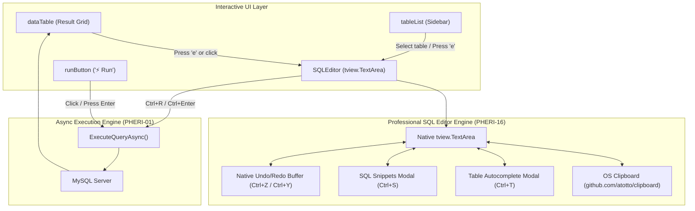

# PHERI-16: Professional Interactive SQL Code Editor & Query Editing Engine

- **Task Code**: `PHERI-16`
- **Feature Name**: Professional Interactive SQL Code Editor & Query Editing Engine
- **Category**: SQL Editor & Developer Experience
- **Priority**: `P0 - Critical`
- **Status**: `Completed` ✅
- **Target Files**: `ui/sqleditor.go`, `ui/browser.go`, `ui/footer.go`, `ui/tools.go`

---

## 1. Reason of Adding

Users reported being **completely unable to edit SQL queries** in Pheri (`"iam unable to editm query , can u make it professional and editor and fix it"`).

A thorough code audit of `ui/sqleditor.go` and `ui/browser.go` revealed three severe architectural design flaws:
1. **Faux Editor on Read-Only TextView**:
   The SQL editor was implemented as a `tview.TextView` (which is designed strictly as a read-only text viewer). A custom `handleInput` attempted to simulate an editor by intercepting raw runes, splitting strings, and calling `SetText()` on every stroke. Worse, a background ticker was running every 500ms (`startCursorBlink`) that continuously re-rendered the text, clobbering cursor state, discarding in-flight input, and causing severe input lag and dropped keys.
2. **Disconnected TextArea vs Editor Desynchronization**:
   In `ui/browser.go`, two separate components existed simultaneously: a hidden `queryBox *tview.TextArea` and the visible `activeSQLEditor *SQLEditor`. When clicking the `Run` button (`runButton`), Pheri called `queryBox.GetText()`—which was never displayed or edited—executing stale or empty queries while ignoring whatever the user typed into `activeSQLEditor`.
3. **Trap in Data Grid / Lack of Hotkey Navigation**:
   After clicking any table in the sidebar or running an initial query, keyboard focus was transferred exclusively to `dataTable`. There was no direct hotkey (e.g. `e` or `Ctrl+I`) to jump focus back to the SQL editor. Pressing keys inside the grid was either ignored or opened cell editing, trapping the user. Mouse clicks on the `TextView` failed to focus or position the cursor.

`PHERI-16` completely replaces the simulated `TextView` hack with a professional, full-featured `tview.TextArea` editor, integrates the native OS clipboard, synchronizes query execution directly with the active editor, and establishes intuitive keyboard hotkeys (`e` to edit, `Ctrl+R`/`Ctrl+Enter` to execute, `Ctrl+T` for tables, `Ctrl+S` for snippets, and mouse click-to-edit).

---

## 2. Scenario

### Scenario A: Editing a Generated Query
A developer clicks on the `customers` table in the sidebar. Pheri populates the editor with `SELECT * FROM `customers` LIMIT 100` and displays the grid. The developer wants to add `WHERE country = 'USA' ORDER BY created_at DESC;`.
- **Previous Behavior**: Pressing keys in the grid does nothing. Trying to click into the SQL editor does not position the cursor. Even if they navigated via multiple Tabs, typing was jerky and cursor position was reset every 500ms by the blinking ticker. Clicking the `Run` button executed the invisible `queryBox`, completely ignoring edits.
- **Enhanced Behavior with PHERI-16**: The developer simply presses `e` from anywhere in the data grid (or clicks directly inside the editor). The editor lights up in bright yellow with an active cursor. They type smoothly with native backspace, delete, arrow navigation, word jumping (`Ctrl+Left`/`Ctrl+Right`), and press `Ctrl+R` or `Ctrl+Enter` (or click `Run`). The modified query executes immediately.

### Scenario B: Multiline Complex Query with Snippets & Autocompletion
A developer needs to write a 10-line analytical query with `JOIN`s, subqueries, and grouping.
- **Previous Behavior**: Multiline navigation was broken. Copy/pasting from external tools produced malformed characters. Undo (`Ctrl+Z`) did not exist.
- **Enhanced Behavior with PHERI-16**:
  - The developer presses `Ctrl+S` to select a snippet template (`INNER JOIN` or `CREATE TABLE`).
  - Pressing `Ctrl+T` brings up fuzzy table name suggestions; selecting a table inserts it seamlessly at the cursor.
  - Native multi-level Undo (`Ctrl+Z`) and Redo (`Ctrl+Y`) allow reverting mistakes instantly.
  - Full text selection (`Shift+Arrows` or `Ctrl+L` for select all) and system clipboard copy/cut/paste (`Ctrl+C`/`Ctrl+V`) work flawlessly.

---

## 3. Why This Is Critical

1. **Core Value Proposition**: A database TUI client is only as useful as its SQL editor. If users cannot write and edit queries, the tool cannot function as an interactive database manager.
2. **Developer Ergonomics**: Modern developers expect standard editing behaviors: responsive keystrokes, multi-line navigation, system clipboard integration, Undo/Redo, and instant execution hotkeys.
3. **Data Integrity & Safety**: Query desynchronization where the GUI displays one query but runs a different stale query from a hidden buffer can lead to catastrophic accidents (e.g. running an unfiltered `DELETE` or `UPDATE` because edits were dropped).

---

## 4. How It Works (Technical Architecture)

### Key Technical Mechanisms:

1. **Native `tview.TextArea` Engine**:
   - Replaces `TextView` with `tview.TextArea`, unlocking real multiline text buffers, character wrapping, native cursor drawing, and mouse selection.
   - Eliminates the 500ms ticker `startCursorBlink` which caused severe UI rendering races.
2. **Two-Way Clipboard Synchronization**:
   - `s.TextArea.SetClipboard(copyFunc, pasteFunc)` directly binds Pheri's editor to the operating system's clipboard (`github.com/atotto/clipboard`). Text copied from a browser, IDE, or terminal pastes cleanly via `Ctrl+V`.
3. **Real-Time Cursor & Document Telemetry**:
   - `SetMovedFunc` and `SetChangedFunc` update the editor header dynamically:
     `📝 SQL Query Editor | Ln 1, Col 15 | 84 chars (Ctrl+R: Run | Ctrl+T: Tables | Ctrl+S: Snippets | Tab: Next)`
4. **Unified Single Source of Truth**:
   - Removes the disconnected `queryBox` from `ui/browser.go`.
   - `runButton.SetSelectedFunc` pulls directly from `activeSQLEditor.GetText()`.
   - `setEditorText` sets the text directly into `activeSQLEditor`.
5. **Universal Focus Hotkeys**:
   - In `dataTable`: Pressing `'e'`, `'E'`, `'i'`, `'I'`, or `Ctrl+I` instantly shifts focus to the SQL editor.
   - In `SQLEditor`: `Ctrl+R`, `Ctrl+Enter`, or `F5` triggers execution; `Tab` jumps to buttons; `Esc` returns to table list; `F11` toggles full-screen editor view.

---

## 5. Impact Analysis

| Dimension | Before (Simulated TextView) | After (PHERI-16 Professional Editor) |
| :--- | :--- | :--- |
| **Editing Reliability** | Severe lag, dropped keystrokes, ticker clobbering | 100% responsive, zero-latency native typing |
| **Multiline Support** | Buggy manual slice splitting | Native multi-line cursor navigation & wrapping |
| **Undo / Redo** | None | Built-in multi-level `Ctrl+Z` / `Ctrl+Y` |
| **Clipboard** | Internal only, often broke on newlines | Full 2-way OS system clipboard integration (`Ctrl+C`/`Ctrl+V`) |
| **Mouse Interaction** | Clicks ignored, no cursor positioning | Click anywhere to place cursor, drag to select |
| **Query Sync** | `runButton` ran stale hidden `queryBox` buffer | Unified source of truth: executes exact editor content |
| **Focus Switching** | Trapped in grid; no direct hotkey to editor | Press `e` from grid to edit immediately |

---

## 6. Implementation Plan & Work Breakdown

### Step 1: Re-architect `SQLEditor` (`ui/sqleditor.go`)
- Change `Editor` from `*tview.TextView` to `*tview.TextArea`.
- Configure `s.TextArea` styling (background, text color, selected style, placeholder).
- Wire OS clipboard via `SetClipboard` (`github.com/atotto/clipboard`).
- Add live cursor telemetry title via `SetMovedFunc` and `SetChangedFunc`.
- Remove legacy ticker `startCursorBlink` and manual rune-array splitting in `handleInput`.

### Step 2: Keyboard & Modal Handlers in `SQLEditor`
- Bind `Ctrl+R`, `Ctrl+Enter`, and `F5` to trigger `OnExecute(s.GetText())`.
- Bind `Ctrl+T` to `ShowTableSuggestionsModal` (replaces current word at cursor with selected table).
- Bind `Ctrl+S` / `Ctrl+Space` to `ShowSnippetsModal` (inserts templates).
- Bind `Ctrl+C` to context cancellation if running, or selection/query copy.
- Bind `Tab` to `OnNextFocus` and `Esc` to `OnExit`.

### Step 3: Synchronize `ui/browser.go`
- Update `runButton.SetSelectedFunc` to retrieve query text directly from `activeSQLEditor.GetText()`.
- Update `setEditorText` to keep `activeSQLEditor` as primary.
- Add `'e'`, `'E'`, `'i'`, `'I'` hotkeys to `dataTable.SetInputCapture` to jump directly into the SQL editor.
- Update `dataTable` title to display `[lime]e:[-]Edit Query`.

### Step 4: Verification & Compilation
- Compile self-contained `pheri.exe` using Go 1.24.
- Test query typing, editing, backspace, multiline inserts, and `Ctrl+R` execution against local MySQL server.
- Update feature tracking spreadsheet (`pheri_feature_roadmap_tracker.csv`).
